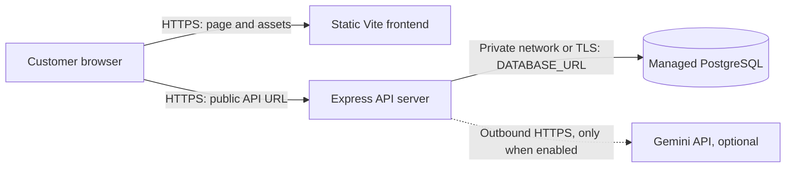

# ShopSmart Deployment Plan

## Service layout

All browser-to-hosted-service connections use HTTPS. The frontend and API are separate origins unless the approved host serves them under one origin. The API-to-database path should use the provider's private network where available, otherwise TLS with database credentials restricted to the application. The API-to-Gemini connection is server-side and optional.

## Hosting and configuration

| Service | Plan | Configuration |
| --- | --- | --- |
| Frontend | Host the contents of `frontend/dist` on an approved static site host/CDN with SPA route fallback to `index.html`. | Set `VITE_API_URL` to the public API base URL ending in `/api` at build time. This value is public and is compiled into browser assets. Rebuild after changing it. |
| API | Run the backend Node.js service on an approved application host. Bind to the host-provided `PORT`. | Set `DATABASE_URL`, `FRONTEND_URL` (the exact deployed frontend origin), and optionally `GEMINI_API_KEY` and `GEMINI_MODEL` in the host's secret/configuration manager. Keep provider credentials only here. Configure CORS to allow the frontend origin. |
| Database | Use a managed PostgreSQL instance compatible with Prisma 6. | Store the connection string as the API host's protected `DATABASE_URL` secret. Restrict database network access and credentials to the API service. Do not put it in Vite variables. |
| Optional AI provider | Gemini, called by the API only when configured. | Keep `GEMINI_API_KEY` in the API host secret store. If no approved key is available, omit it; the deterministic assistant remains available. |

The deployed `/api/health` endpoint now checks PostgreSQL as well as the API process: HTTP 200 indicates its database query succeeded; HTTP 503 indicates the database is unavailable. Configure the hosting platform's health probe to use the public API URL plus `/api/health`.

## Release and database sequence

1. Create the managed database and set `DATABASE_URL` securely on the API host.
2. Deploy the API code with the committed Prisma migrations. Before serving traffic, run `npm run db:migrate:deploy` from the repository root (or `npm run db:migrate:deploy --workspace backend`). This invokes Prisma 6 `prisma migrate deploy` and applies committed migrations without the development workflow's schema prompts.
3. Do not run `npm run db:seed` against staging or production. It deletes orders and products before reseeding. Add sample catalog rows through a reviewed, non-destructive process if required.
4. Build and deploy the frontend with `VITE_API_URL` set to the API's public `.../api` URL.
5. Set `FRONTEND_URL` to the exact browser origin. Verify CORS permits that origin and rejects unapproved origins.
6. Restrict staging access with the hosting platform's access controls. Until authentication and privacy protections are added, use fictional customer details only and do not make checkout publicly available.
7. Verify `/api/health`, product listing/search, assistant match and no-match behavior, invalid checkout, stock rejection, and one simulated checkout with fictional details. Record URL, date, and results without recording credentials.
8. Confirm no secret appears in committed files, build output, logs, or screenshots. Keep a rollback path to the previous frontend/API release and take database backups according to the host's retention policy.

## Current status

This is a plan only. No hosting provider or database was approved or configured for this task; ShopSmart remains a local release candidate. No live URL or staging credentials are available.
